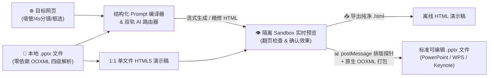

<div align="center">

# ⚡ Web Reverse Inspector

**纯客户端网页特效 / 界面全图层逆向 & PPTX 双向高保真复刻 Chrome 扩展（Manifest V3）**

[](./CHANGELOG.md)
[](#快速安装)
[-6366f1?style=flat-square)](#架构设计)
[](./LICENSE)

**简体中文** | [English](./README_EN.md) | [双语版本说明 (Changelog)](./CHANGELOG.md) | [工程蓝图 (BRIEF.md)](./BRIEF.md)

</div>

---

## ✨ 项目简介

**Web Reverse Inspector** 是一款 **100% 纯客户端、零后端、免打包（无需 Webpack / Vite）** 的 Chrome 常驻侧边栏（SidePanel）扩展，直接通过原生 ES Modules + HTML5 + CSS3 驱动。它打通了两大高频创作与逆向闭环：

1. **🌐 网页特效与界面 95%+ 逆向**：不靠盲目截图猜代码——通过 Shadow DOM 吸管、选区全图层扫描、Web Components 穿透、**4 秒多节点交互录制 + 2×2 动态分镜图**、局部高清框选截图，直接生成结构化、抗臆造的高还原度 AI 复刻 Prompt，并支持直连大模型流式生成与安全 Sandbox 实时预览。
2. **📽️ PPTX ⇄ HTML 双向高保真复刻闭环**：
   - **`.pptx` → Prompt / 1:1 HTML 演示稿**：内置零依赖原生 ZIP 解压器与 **OOXML 四级继承链解析引擎（`Theme → SlideMaster → SlideLayout → Slide`）**，一键提取精确主题色、明度修饰、坐标、矢量形状、表格、图表、内嵌图片、动画与备注，直接输出 95%+ 复刻 Prompt 与 1:1 等比缩放单文件 HTML5 演示稿。
   - **HTML 演示稿预览确认 → 可编辑 `.pptx` 一键导出**：无论是在本地解析的 1:1 HTML、AI 流式改写/新建的 HTML 演示稿，还是网页逆向生成的页面，只要在 Sandbox 实时预览中确认无误，点击 **【📊 确认并导出 `.pptx`】**，即可通过浏览器真实排版测量探针与严格合规的 OOXML 打包引擎，本地输出可在 **Microsoft PowerPoint / WPS Office / Apple Keynote** 中继续自由编辑的 `.pptx` 文件！

---

## 🚀 核心功能一览

### 1. 网页双模态特征采集（Shadow DOM 隔离）
- **🎯 吸管抓取特效**：独立 Shadow DOM 高亮框与实时特效标注（`Transition` / `Anim` / `Glass` / `3D/Transform` / `ShadowDOM` / `Canvas/Media`），支持透明覆盖层穿透与开放 `shadowRoot` 穿透。
- **🧩 选区全图层布局扫描 (`scanRegionLayout`)**：不依赖单一 hit-test，完整扫描选区内背景 `<video>` / `<canvas>`、色块容器与前景文字控件的相对百分比坐标与聚合样式。
- **🎬 4 秒动态分镜录制**：`MutationObserver` + `rAF` 联动监控最多 70 个交互节点、鼠标轨迹与滚动位移，自动抓取 4 帧关键画面并由 `OffscreenCanvas` 拼接为带时间/坐标标注的 **2×2 动态分镜故事板 PNG**。
- **📸 局部框选高清截图 & 纯色告警**：Shadow DOM 十字准星自由框选裁剪高清 PNG；自动检测主色占比 >90% 的异常纯色截图并告警。
- **🧹 CSS 降噪与跨域 `@keyframes` 提取**：过滤浏览器默认冗余简写，并由后台并发拉取跨域样式表补全动画关键帧。

### 2. PPTX 95%+ 复刻 & HTML ⇄ PPTX 双向转换引擎
- **📦 零依赖原生 ZIP 解压与打包 (`utils/zip-lite.js`)**：基于浏览器原生 `DecompressionStream('deflate-raw')` / `CompressionStream('deflate-raw')` 与标准 IEEE CRC-32，兼容 Data Descriptor 与 UTF-8 文件名。
- **🧬 OOXML 四级继承解析 (`utils/pptx-parser.js`)**：完整实现 `Theme → SlideMaster → SlideLayout → Slide` 颜色映射与 `lumMod / lumOff / tint / shade / satMod / alpha` 色彩演算、`<p:grpSp>` 组图形递归坐标映射、预设/自定义几何路径、图片裁剪 `srcRect`、合并单元格表格、图表摘要、切页过渡、入场动画与演讲者备注。
- **🎞️ 1:1 单文件 HTML5 演示稿 (`utils/pptx-html-renderer.js`)**：等比缩放舞台锁死比例、内嵌 Base64 媒体、键盘 `←/→/Space` 翻页、全屏放映、演讲者备注抽屉与纯净 `.html` 离线导出。
- **📊 Sandbox 真实排版测量 + 可编辑 `.pptx` 生成 (`utils/html-slide-extractor.js` & `utils/pptx-exporter.js`)**：
  - 仅在预览沙箱内通过 `postMessage` 注入轻量探针（导出 `.html` 保持 100% 纯净），临时冻结动画与消除缩放后测量每页真实逻辑坐标；
  - 文本与行内富文本混排（字号 `px→pt`、加粗/斜体/下划线/变色、同时写入 `<a:latin>` 与 `<a:ea>` 防中文退化）、纯色与多色标线性渐变（渐变角与解析器 100% 互逆）、圆角/边框/外阴影/旋转、原生 `<table>` 合并单元格、图片裁剪与 CRC-32 去重全部转为 **PowerPoint / WPS 原生可编辑对象**；
  - `<svg>` 图表/图标与 `<canvas>` 画面自动按 **2x 超清透明底 PNG** 嵌入保真。

### 3. 无服务端双轨大模型路由
- **🌐 官方 Web 套餐零侵入桥接**：复用本地浏览器已登录的 **ChatGPT Web**（支持 GPT-6.2 Astra 等最新官方菜单模型切换）与 **Gemini Web**（支持 4 Argon / 4 Carbon / 4 Hydrogen / 3.1 Pro 等，带未解锁状态检测与 RPC 兜底），零修改宿主页面原生 API。
- **🔑 自备 API Key（BYOK）直连**：支持 Google AI Studio（Gemini API）与 OpenAI 官方 API 多模态 SSE 流式直连，密钥仅保存在本地 `chrome.storage.local`。
- **📋 离线纯净回退**：未登录且未配 Key 时仍可无损产出完整结构化复刻 Prompt 与高清截图（一键复制截图 + 一键复制 Prompt）。

---

## 🧭 工作流架构



---

## 📦 快速安装

本扩展为纯原生 ES Modules 工程，**无需 `npm install` 或构建打包**，30 秒即可加载运行：

1. **获取源码**（二选一）：
   - 前往 [Releases](https://github.com/633qaq/web-reverse-inspector/releases) 下载最新 `web-reverse-inspector-v1.4.0.zip` 并解压；
   - 或直接克隆仓库：
     ```bash
     git clone https://github.com/633qaq/web-reverse-inspector.git
     ```
2. 在 Chrome / Edge 地址栏打开 `chrome://extensions/`。
3. 打开右上角 **「开发者模式」**（Developer mode）。
4. 点击 **「加载已解压的扩展程序」**（Load unpacked），选择包含 `manifest.json` 的文件夹。
5. 点击浏览器工具栏扩展图标，打开常驻侧边栏即可开始使用！

---

## ⚠️ 已知技术边界（透明说明）

| 场景 | 当前能力与客观边界 |
| :--- | :--- |
| **HTML → `.pptx` 原生可编辑范围** | 坐标比例、文字与富文本混排、纯色/线性渐变、圆角/边框/阴影/旋转、合并单元格表格、`` 裁剪与演讲者备注均为 **原生可编辑对象**；`<svg>` 与 `<canvas>` 转为 **2x 超清透明 PNG** 嵌入。 |
| **Web 专属动态/滤镜特性** | `backdrop-filter` 实时毛玻璃、WebGL 实时交互、CSS `@keyframes` 循环动画与 JS 点击逻辑在 `.pptx` 文件规范中无 1:1 动态等价物，静态外观会尽力保真，动态交互不会保留。 |
| **字体与外链图片** | `.pptx` 仅写入字体名称，目标电脑若未安装对应网页字体会触发系统字体回退；受浏览器 CORS 策略限制，未开放跨域头的外链图片无法被离线打包（Base64、内联 SVG、Canvas 与开放 CORS 图片可 100% 嵌入）。 |
| **桌面 PPT 软件进程** | 严格遵循纯客户端 Chrome 扩展架构，通过文件上传与导出形成闭环，不直接读写桌面 PowerPoint / WPS 进程内存。 |

---

## 📁 工程目录结构

```text
web-reverse-inspector/
├── manifest.json               # Chrome Manifest V3 清单 (v1.4.0)
├── README.md / README_EN.md    # 中英双语使用说明
├── CHANGELOG.md                # 中英双语版本发布记录
├── BRIEF.md                    # 实时工程蓝图与规格说明书
├── LICENSE                     # MIT 开源协议
├── sidepanel/                  # 常驻侧边栏 UI（双模式工作台、调试 5 标签页、Sandbox 预览与导出）
├── content/                    # Shadow DOM 注入采集器（inspector / recorder / cropper）
├── background/                 # Service Worker 消息总线、分镜拼接与双轨大模型路由
└── utils/                      # 零依赖核心引擎（zip-lite / pptx-parser / pptx-html-renderer / html-slide-extractor / pptx-exporter / prompt-compiler / style-filter）
```

---

## 📄 开源协议与隐私声明

- 本项目基于 [MIT License](./LICENSE) 开源。
- **隐私承诺**：本扩展为 100% 纯客户端运行，**不包含任何自建后端服务器、埋点统计或数据收集代码**。您配置的 API Key 仅存储在本地 `chrome.storage.local`，上传解析的 `.pptx` 文件与生成的 `.pptx` / `.html` 均完全在您本机浏览器内存中完成处理。
