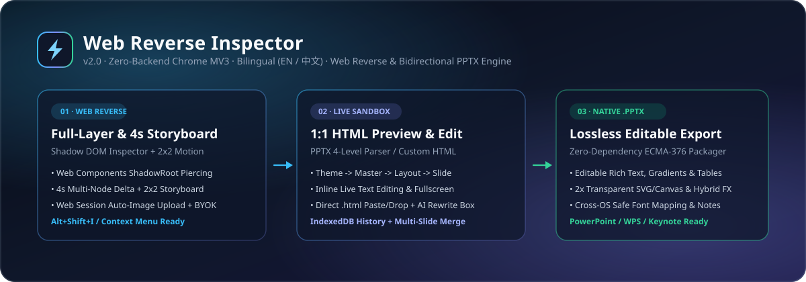
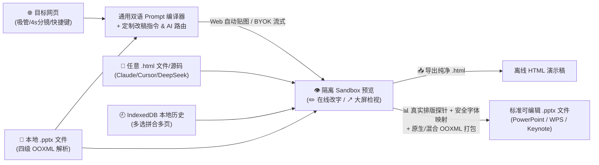

<div align="center">



# ⚡ Web Reverse Inspector

**纯客户端网页特效 / 界面全图层逆向 & PPTX ⇄ HTML 双向高保真复刻 Chrome 扩展（Manifest V3）**

[](./CHANGELOG.md)
[](#核心功能一览)
[](#快速安装)
[-6366f1?style=flat-square)](#工作流架构)
[](./LICENSE)

**简体中文** | [English](./README_EN.md) | [双语版本说明 (Changelog)](./CHANGELOG.md) | [工程蓝图 (BRIEF.md)](./BRIEF.md)

</div>

---

## ✨ 项目简介

**Web Reverse Inspector v2.0** 是一款 **100% 纯客户端、零后端、免打包（无需 Webpack / Vite）** 的 Chrome 常驻侧边栏（SidePanel）扩展，内置中英双语无缝热切换与官方高清图标，打通三大高能创作与逆向闭环：

1. **🌐 网页特效与界面 95%+ 逆向**：通过 Shadow DOM 吸管、选区全图层扫描、Web Components 穿透、**4 秒多节点交互录制 + 2×2 动态分镜图**、局部框选截图（支持网页右键菜单与 `Alt+Shift+I` / `Alt+Shift+C` 全局快捷键），编译**去偏置通用双语复刻 Prompt**，支持自定义改稿指令与 Web 套餐自动贴图发送。
2. **📽️ PPTX 95%+ 本地解析与 AI 套版改稿**：零依赖原生 ZIP 解压 + **OOXML 四级继承链解析（`Theme → SlideMaster → SlideLayout → Slide`）**，支持柱状/折线/饼图 SVG 渲染、主题色修饰演算、合并表格、动画与备注，直接输出 95%+ 复刻 Prompt（支持自定义换文案/换主题指令）与 1:1 单文件 HTML5 演示稿。
3. **📄 任意 HTML → 原生可编辑 `.pptx` 无损转换闭环**：新增独立 **「📄 HTML → PPTX」** 工作台——无论是本地 1:1 渲染稿、AI 流式改写稿、历史记录多页拼合稿，还是直接拖入/粘贴的 **Claude / Cursor / DeepSeek 生成的 `.html` 演示稿**，均可先在 Sandbox 中 **✏️ 在线改字**、**↗ 新标签页大屏检视**，确认无误后一键导出在 **PowerPoint / WPS / Keynote** 中原生可编辑的 `.pptx` 文件！

---

## 🚀 核心功能一览

### 1. 网页双模态特征采集 & 快捷入口
- **🎯 Shadow DOM 吸管 & 全图层扫描 (`scanRegionLayout`)**：穿透透明遮罩与开放 `shadowRoot`，精准采集背景 `<video>` / `<canvas>`、色块容器与前景文字控件的相对坐标、降噪 CSS 与跨域 `@keyframes`。
- **🎬 4 秒动态分镜录制**：监控最多 70 个交互节点、鼠标轨迹与滚动位移，自动合成带标注的 **2×2 动态分镜故事板 PNG**。
- **⌨️ 右键菜单与全局快捷键**：页面右键菜单一键触发采集，或直接按下 `Alt+Shift+I`（混合吸管）/ `Alt+Shift+C`（局部框选）秒开侧边栏采集。

### 2. PPTX ⇄ HTML 双向高保真引擎（v2.0 全面增强）
- **🧬 四级 OOXML 解析 + 三类图表 SVG**：完整解析母版/版式/主题色修饰器、组合图形、表格与备注，支持柱状图、多系列折线/面积图与饼图/环形图渲染。
- **📄 独立「HTML → PPTX」工作台**：直接拖入 `.html` 文件或粘贴任意 HTML 演示稿源码，立刻载入 Sandbox 预览并一键转 `.pptx`。
- **✏️ Sandbox 在线改字 + ↗ 大屏检视**：开启 `✏️ 改字` 直接点击修改任意标题或数据，修改内容自动同步到 `.pptx` / `.html` 导出与新标签页大屏预览！
- **⚙️ 双导出模式 + 跨平台安全字体映射**：
  - **标准原生可编辑模式（默认）**：文字、富文本、渐变、圆角、阴影、旋转、合并表格、裁剪图片与演讲者备注全部为 PowerPoint 原生可编辑对象；`<svg>` / `<canvas>` 2x 超清透明 PNG 保真；
  - **视觉混合保真模式**：针对重度毛玻璃/复杂滤镜卡片，将装饰底板 2x 融合光栅化，同时保留前景文字为原生可编辑文本框；
  - **安全字体映射**：自动将 `PingFang SC / Noto Sans SC / Inter` 等映射为跨平台高兼容 `Microsoft YaHei / Arial`，大幅减少换电脑打开跑版。

### 3. 全生态 AI 路由 + 定制改稿 + 本地历史拼合
- **🎯 自定义改稿 / 换风格指令框**：内置快捷芯片（`1:1 原样` / `套版换文案` / `浅色商务风` / `精简提炼`），支持中英双语通用 Prompt 输出（彻底去除特定案例偏置）。
- **🌐 Web 套餐自动附带截图**：ChatGPT Web（GPT-6.2 Astra 等）与 Gemini Web（4 Argon 等）自动通过 `DataTransfer` / `ClipboardEvent` 附带截图或分镜图发送。
- **🔑 BYOK 全生态兼容（自定义 Base URL）**：支持 Google AI Studio，以及自定义 Base URL 的 OpenAI-Compatible 接口（无缝支持 **DeepSeek、OpenRouter、硅基流动、企业中转与本地免 Key Ollama**）。
- **🕘 IndexedDB 本地历史记录 & 多页拼合**：自动保存最近 25 条捕获/生成记录防手滑丢失，支持一键恢复及**勾选多条单页记录拼合为一份多页 `.pptx` 演示稿**！

### 4. 原生中英双语运行界面（简体中文 ⇄ English）
- 内置 Chrome `_locales` 多语言清单与 **226 组** 对称中英词条，首次安装自动跟随浏览器语言，点击侧边栏右上角 **`EN / 中文`** 按钮即可毫秒级实时热切换。

---

## 🧭 工作流架构



---

## 📦 快速安装

纯原生 ES Modules 工程，**无需 `npm install` 或构建打包**，30 秒即可加载运行：

1. **获取源码**（二选一）：
   - 前往 [Releases](https://github.com/633qaq/web-reverse-inspector/releases) 下载最新 `web-reverse-inspector-v2.0.0.zip` 并解压；
   - 或克隆仓库：
     ```bash
     git clone https://github.com/633qaq/web-reverse-inspector.git
     ```
2. 在 Chrome / Edge 打开 `chrome://extensions/`，开启右上角 **「开发者模式」**。
3. 点击 **「加载已解压的扩展程序」**，选择包含 `manifest.json` 的文件夹。
4. 点击工具栏闪电图标打开侧边栏，或直接在任意网页按 `Alt+Shift+I` / 右键菜单开启捕获！

---

## ⚠️ 已知技术边界（透明说明）

| 场景 | 当前能力与客观边界 |
| :--- | :--- |
| **HTML → `.pptx` 原生可编辑范围** | 坐标比例、富文本混排、纯色/线性渐变、圆角/边框/阴影/旋转、合并表格、`` 裁剪与演讲者备注均为 **原生可编辑对象**；`<svg>` 与 `<canvas>` 按 **2x 透明 PNG** 嵌入；重度毛玻璃卡片可开启 **视觉混合保真模式**。 |
| **Web 专属动态特性** | 实时 WebGL 交互、CSS `@keyframes` 循环动画与 JS 点击逻辑在静态 `.pptx` 规范中无 1:1 动态等价物，转换时保留静态外观。 |
| **外链图片与 Web 自动贴图** | 未开放 CORS 的外链图受浏览器安全策略限制无法离线抓取（Base64 / SVG / Canvas / 开放 CORS 图片可 100% 离线打包）；若 ChatGPT / Gemini 官网改版拦截自动贴图，扩展将优雅降级为纯文本发送，可点击【📸 复制截图】手动粘贴。 |

---

## 📄 开源协议与隐私声明

- 本项目基于 [MIT License](./LICENSE) 开源。
- **隐私承诺**：100% 纯客户端运行，**零自建后端、零埋点统计、零数据上传**。API Key 仅存于本地 `chrome.storage.local`，历史记录仅存于本地 `IndexedDB`，所有文件解析与 `.pptx` 生成均在您本机浏览器内存中完成。
