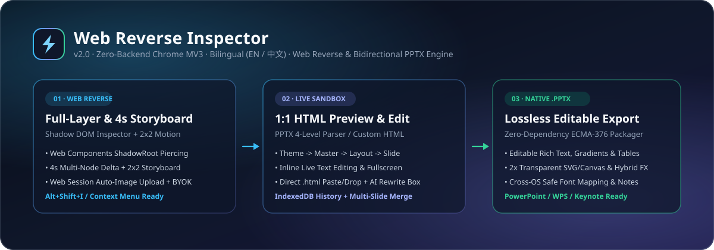
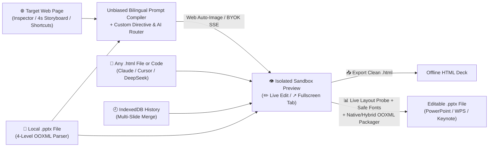

<div align="center">



# ⚡ Web Reverse Inspector

**100% Client-Side Chrome Extension (Manifest V3) for Full-Layer Web UI/Motion Reverse Engineering & Bidirectional High-Fidelity PPTX ⇄ HTML Conversion**

[](./CHANGELOG.md)
[](#key-features)
[](#quick-installation)
[-6366f1?style=flat-square)](#architecture)
[](./LICENSE)

[简体中文](./README.md) | **English** | [Bilingual Changelog](./CHANGELOG.md) | [Engineering Brief](./BRIEF.md)

</div>

---

## ✨ Overview

**Web Reverse Inspector v2.0** is a **pure client-side, zero-backend, zero-build-step** Chrome SidePanel extension built with Vanilla ES Modules, HTML5, and CSS3—complete with official icons, instant English ⇄ Chinese UI switching, and three end-to-end pipelines:

1. **🌐 Full-Layer Web UI & Motion Reverse Engineering (95%+ Fidelity)**:
   Capture live web components inside an isolated Shadow DOM, pierce open Web Components (`shadowRoot`), run full-region layer scans (`scanRegionLayout`), record **4-second multi-node interactions with 2×2 dynamic storyboards**, and trigger instantly via browser context menus or global shortcuts (`Alt+Shift+I` / `Alt+Shift+C`). Compiles unbiased bilingual prompts with custom rewrite directives and automatic screenshot attachment for web AI sessions.
2. **📽️ Local PPTX 95%+ Parsing & AI Restyling**:
   Zero-dependency native ZIP reader + **4-level OOXML inheritance parser (`Theme → SlideMaster → SlideLayout → Slide`)** supporting bar/line/pie SVG charts, theme color transforms, merged tables, animations, and speaker notes—outputting 95%+ prompts (with custom rewrite/restyle directives) and 1:1 HTML5 slide decks.
3. **📄 Any HTML → Native Editable `.pptx` Export Loop**:
   Includes a dedicated **「📄 HTML → PPTX」** workbench! Drop or paste any single-file HTML deck (from local PPTX parsing, AI streaming, merged history slides, or external tools like **Claude / Cursor / DeepSeek**), preview it in the Sandbox with **✏️ inline live text editing** and **↗ fullscreen tab view**, then export a clean, editable `.pptx` file for **PowerPoint, WPS Office, and Keynote**.

---

## 🚀 Key Features

### 1. Dual-Modal Web Capture & Quick Entry
- **🎯 Shadow DOM Inspector & Full-Layer Scanner (`scanRegionLayout`)**: Pierces transparent overlays and open `shadowRoot` trees to capture background `<video>` / `<canvas>`, surfaces, foreground controls, noise-filtered CSS, and cross-origin `@keyframes`.
- **🎬 4-Second Dynamic Storyboard**: Tracks up to 70 interactive nodes, pointer trajectories, and scroll deltas into an annotated **2×2 Storyboard PNG**.
- **⌨️ Context Menu & Global Shortcuts**: Right-click any webpage to capture directly, or press `Alt+Shift+I` (Hybrid Inspector) / `Alt+Shift+C` (Region Crop).

### 2. Bidirectional PPTX ⇄ HTML Engine (Supercharged in v2.0)
- **🧬 4-Level OOXML Parser + Bar / Line / Pie SVG Charts**: Resolves Master/Layout/Theme color modifiers, recursive group shapes, merged tables, transitions, timing animations, and speaker notes.
- **📄 Direct「HTML → PPTX」Workbench**: Drag & drop `.html` files or paste raw HTML slide code directly into Sandbox preview and convert to editable `.pptx`.
- **✏️ Inline Live Text Editing + ↗ Fullscreen Tab View**: Toggle `✏️ Edit` to click and fix any headline or data directly in the preview; edits sync automatically to `.pptx`, `.html`, and fullscreen view.
- **⚙️ Dual Export Modes + Cross-OS Safe Font Mapping**:
  - **Standard Native Editable (Default)**: Rich text, multi-stop gradients, rounded shapes, borders, shadows, rotations, merged tables, cropped/deduplicated images, and notes export as native editable PowerPoint objects; `<svg>` & `<canvas>` rasterize at 2x transparent PNG.
  - **Hybrid Visual Fidelity Mode**: Rasterizes heavy `backdrop-filter`/filtered card surfaces at 2x while keeping foreground text 100% natively editable.
  - **Safe Font Mapping**: Maps `PingFang SC / Noto Sans SC / Inter / JetBrains Mono` to universal `Microsoft YaHei / Arial / Consolas` to prevent wrapping shifts across OSes.

### 3. Universal AI Routing + Custom Directives + Local History Merge
- **🎯 Custom AI Rewrite / Restyle Directive Box**: Includes quick preset chips (`1:1 Exact`, `Swap Copy`, `Light Biz`, `Tighten Copy`) with unbiased bilingual prompt compilation.
- **🌐 Web Session Auto-Image Attachment**: Automatically attaches captured screenshots/storyboards to **ChatGPT Web** and **Gemini Web** via `DataTransfer` / `ClipboardEvent('paste')` (with graceful fallback).
- **🔑 BYOK Custom Base URL**: Supports Google AI Studio plus any OpenAI-Compatible endpoint (**DeepSeek, OpenRouter, SiliconFlow, custom proxies, and keyless local Ollama**).
- **🕘 IndexedDB Local History & Multi-Slide Merge**: Automatically stores the last 25 sessions locally—restore any session in one click, or select multiple single-slide items to **merge into a multi-slide HTML deck & export as a multi-slide `.pptx`**!

### 4. Built-in Bilingual Runtime UI (English ⇄ 简体中文)
- Ships with native Chrome `_locales` (`en` / `zh_CN`) and **226 matched bilingual keys**. Auto-detects Chrome language and toggles instantly via the top-right **`中文 / EN`** button.

---

## 🧭 Architecture



---

## 📦 Quick Installation

Zero build step—load directly in Chrome / Edge in 30 seconds:

1. **Get the extension**:
   - Download and unzip `web-reverse-inspector-v2.0.0.zip` from [Releases](https://github.com/633qaq/web-reverse-inspector/releases); or
   - Clone this repository:
     ```bash
     git clone https://github.com/633qaq/web-reverse-inspector.git
     ```
2. Open `chrome://extensions/` and enable **Developer mode**.
3. Click **Load unpacked** and select the folder containing `manifest.json`.
4. Click the toolbar icon to open the SidePanel, or press `Alt+Shift+I` / right-click any webpage!

---

## ⚠️ Technical Boundaries & Transparency

| Category | Behavior & Limits |
| :--- | :--- |
| **Native Editable PPTX** | Coordinates, rich text, solid/linear gradients, rounded shapes, borders, shadows, rotations, merged tables, cropped images, and notes export as **native editable PPTX elements**; `<svg>`/`<canvas>` embed as 2x transparent PNGs; use **Hybrid Mode** for heavy glassmorphism cards. |
| **Web-Only Dynamic FX** | Interactive WebGL shaders, looping CSS `@keyframes`, and JS event handlers have no dynamic 1:1 equivalent in the static `.pptx` spec. |
| **External Images & Web Upload** | Non-CORS external images cannot be captured offline by Canvas; if ChatGPT/Gemini web updates block synthetic paste uploads, sending gracefully continues with text while allowing manual paste via `[📸 Copy Image]`. |

---

## 📄 License & Privacy

- Licensed under the [MIT License](./LICENSE).
- **Privacy First**: 100% client-side execution with **zero backend servers, zero telemetry, and zero tracking**. API keys stay in local `chrome.storage.local`, history stays in local `IndexedDB`, and all `.pptx` processing runs strictly inside your browser.
