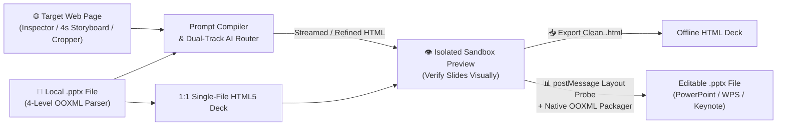

<div align="center">

# ⚡ Web Reverse Inspector

**A 100% Client-Side Chrome Extension (Manifest V3) for Full-Layer Web UI/Effect Reverse Engineering & High-Fidelity Bidirectional PPTX ⇄ HTML Conversion**

[](./CHANGELOG.md)
[](#key-features)
[](#quick-installation)
[-6366f1?style=flat-square)](#architecture)
[](./LICENSE)

[简体中文](./README.md) | **English** | [Bilingual Changelog](./CHANGELOG.md) | [Engineering Brief](./BRIEF.md)

</div>

---

## ✨ Overview

**Web Reverse Inspector** is a **pure client-side, zero-backend, zero-build-step** Chrome SidePanel extension built with Vanilla ES Modules, HTML5, and CSS3. Simply load the folder directly via Chrome `Load unpacked`—no Webpack, Vite, or server required.

It delivers two end-to-end reverse-engineering & creation pipelines:

1. **🌐 Full-Layer Web UI & Motion Reverse Engineering (95%+ Fidelity)**:
   Stop guessing layouts from raw screenshots. Inspect elements inside an isolated Shadow DOM, pierce transparent overlays & open Web Components (`shadowRoot`), run full-region multi-layer layout scans (`scanRegionLayout`), record **4-second multi-node interactions with 2×2 dynamic storyboards**, and capture high-DPI cropped PNGs to compile anti-hallucination AI replication prompts—with live streaming previews in a sandboxed iframe.
2. **📽️ Bidirectional PPTX ⇄ HTML High-Fidelity Engine**:
   - **`.pptx` → 95%+ Replication Prompt & 1:1 HTML5 Deck**: Powered by a zero-dependency ZIP engine and a 4-level OOXML inheritance parser (`Theme → SlideMaster → SlideLayout → Slide`), extracting theme color transforms (`lumMod/lumOff/tint/shade/satMod/alpha`), exact EMU coordinates, recursive group shapes, vector paths, merged tables, chart summaries, embedded media, animations, and speaker notes.
   - **HTML Deck Preview Confirmation → Editable `.pptx` One-Click Export**: Preview any HTML slide deck inside the Sandbox (whether locally rendered 1:1 from PPTX, refined/created by AI streaming, or reverse-engineered from the web). Once satisfied, click **【📊 Confirm & Export `.pptx`】** to measure real browser layout via a `postMessage` probe and package a clean, native, editable `.pptx` file compatible with **Microsoft PowerPoint, WPS Office, and Apple Keynote**.

---

## 🚀 Key Features

### 1. Dual-Modal Web Feature Capture (Shadow DOM Isolated)
- **🎯 Shadow DOM Inspector**: Non-intrusive highlight box & badge tagging (`Transition`, `Anim`, `Glass`, `3D/Transform`, `ShadowDOM`, `Canvas/Media`), piercing transparent overlays and open `shadowRoot` trees.
- **🧩 Full-Region Layer Scanner (`scanRegionLayout`)**: Enumerates background `<video>` / `<canvas>`, color containers, and foreground controls with exact relative percentage coordinates and aggregated button styles.
- **🎬 4-Second Dynamic Storyboard Recorder**: Tracks up to 70 interactive nodes via `MutationObserver` + `rAF`, mouse trajectories, and scroll deltas, stitching 4 timestamped keyframes into a **2×2 Storyboard PNG** via `OffscreenCanvas`.
- **📸 Region Cropper & Solid-Color Guard**: Crosshair marquee cropping with automatic dominant-color anomaly warnings (>90% single color).
- **🧹 Noise-Filtered CSS & Cross-Origin `@keyframes`**: Strips verbose browser defaults and fetches cross-origin stylesheets in the background worker to recover complete keyframe animations.

### 2. PPTX 95%+ Replication & HTML ⇄ PPTX Bidirectional Pipeline
- **📦 Zero-Dependency Native ZIP Reader & Writer (`utils/zip-lite.js`)**: Built on browser-native `DecompressionStream('deflate-raw')` / `CompressionStream('deflate-raw')` and IEEE CRC-32, supporting Data Descriptors and UTF-8 entry names.
- **🧬 4-Level OOXML Inheritance Parser (`utils/pptx-parser.js`)**: Resolves `Theme → SlideMaster → SlideLayout → Slide`, color maps/modifiers, recursive `<p:grpSp>` transforms, `<a:prstGeom>` / `<a:custGeom>`, image `srcRect` crops, merged `<a:tbl>` tables, chart summaries, transitions, timing animations, and speaker notes.
- **🎞️ 1:1 Single-File HTML5 Slide Renderer (`utils/pptx-html-renderer.js`)**: Aspect-ratio-locked scalable stage, embedded Base64 media, keyboard navigation (`←/→/Space`), fullscreen mode, speaker notes drawer, and clean offline `.html` export.
- **📊 Real-Layout Sandbox Probe + Native `.pptx` Exporter (`utils/html-slide-extractor.js` & `utils/pptx-exporter.js`)**:
  - Injects a lightweight measurement probe only inside the preview sandbox (`iframe[sandbox="allow-scripts"]`) without touching copied or exported `.html` code.
  - Converts coordinates, multi-run rich text (`px → pt`, explicit `<a:latin>` + `<a:ea>` font tags to prevent CJK font fallback), solid & multi-stop linear/radial gradients (mathematically reversible CSS-angle ↔ OOXML `ang`), rounded rectangles/ellipses, borders, outer shadows, rotations, merged native tables (`colspan`/`rowspan`), cropped/deduplicated images, and speaker notes into **native editable PowerPoint objects**.
  - Rasterizes complex `<svg>` graphics/charts and `<canvas>` visuals at **2x crisp transparent PNG** to prevent cross-platform vector distortion.

### 3. Serverless Dual-Track AI Model Router
- **🌐 Official Web Subscription Bridge (Zero Monkey-Patching)**: Reuses your active browser sessions for **ChatGPT Web** (supporting latest menu models such as GPT-6.2 Astra) and **Gemini Web** (supporting 4 Argon, 4 Carbon, 4 Hydrogen, 3.1 Pro, with lock-state detection and RPC fallback).
- **🔑 Bring Your Own Key (BYOK) Direct SSE**: Native multimodal streaming to Google AI Studio (Gemini API) and OpenAI API, with keys stored strictly locally in `chrome.storage.local`.
- **📋 Offline Pure Prompt Fallback**: Works completely offline with zero account/API required—outputs structured replication prompts plus one-click screenshot & prompt clipboard export.

### 4. Built-in Bilingual UI (English ⇄ 简体中文 Instant Switch)
- **🌍 Auto-Detect + One-Click Toggle**: Ships with native Chrome `_locales` (`en` / `zh_CN`) manifest localization, auto-detects browser UI language on first launch, and lets you switch instantly between **English** and **简体中文** via the top-right **`中文 / EN`** button (persisted in `chrome.storage.local`).
- **End-to-End Coverage**: Covers the entire SidePanel UI, model menus, channel status messages, Shadow DOM in-page capture banners (inspector, 4s recorder, region cropper), and the 1:1 HTML deck player toolbar.

---

## 🧭 Architecture



---

## 📦 Quick Installation

No `npm install`, no bundler—load directly in Chrome / Edge in 30 seconds:

1. **Get the source** (pick one):
   - Download and unzip `web-reverse-inspector-v1.5.0.zip` from [Releases](https://github.com/633qaq/web-reverse-inspector/releases); or
   - Clone the repository:
     ```bash
     git clone https://github.com/633qaq/web-reverse-inspector.git
     ```
2. Navigate to `chrome://extensions/`.
3. Enable **Developer mode** in the top-right corner.
4. Click **Load unpacked** and select the folder containing `manifest.json`.
5. Click the extension icon in your toolbar to open the persistent SidePanel.

---

## ⚠️ Technical Boundaries & Transparency

| Category | Behavior & Format Limits |
| :--- | :--- |
| **Native Editable PPTX Objects** | Slide ratios, exact coordinates, multi-run rich text, solid & linear gradients, rounded shapes, borders, shadows, rotations, merged tables, cropped images, and speaker notes are exported as **native editable PPTX elements**. `<svg>` and `<canvas>` elements are embedded as **2x crisp transparent PNGs**. |
| **Web-Only Effects** | Live `backdrop-filter` glass blur, interactive WebGL shaders, looping CSS `@keyframes`, and JS click handlers have no 1:1 dynamic equivalent in the `.pptx` spec; static appearances are preserved as closely as possible without dynamic interactivity. |
| **Fonts & External Images** | `.pptx` stores font family names; missing web fonts on the target machine fall back to OS fonts. Cross-origin external `` URLs without CORS headers cannot be captured offline by Canvas (Base64 images, inline SVGs, Canvas, and CORS-enabled images pack 100% offline). |
| **Desktop Office Processes** | Strictly adheres to Chrome's client-side sandbox—operates via `.pptx` upload and export rather than hooking into desktop PowerPoint/WPS processes. |

---

## 📁 Project Structure

```text
web-reverse-inspector/
├── manifest.json               # Chrome Manifest V3 manifest (v1.5.0 with _locales)
├── _locales/                   # Native Chrome manifest locales (en / zh_CN)
├── README.md / README_EN.md    # Bilingual documentation (ZH / EN)
├── CHANGELOG.md                # Bilingual release history
├── BRIEF.md                    # Live engineering specification
├── LICENSE                     # MIT License
├── sidepanel/                  # Persistent SidePanel UI (ZH/EN live switch, dual workbench, 5 debug tabs, sandbox & exporters)
├── content/                    # Shadow DOM capture scripts (bilingual banners: inspector / recorder / cropper)
├── background/                 # Service Worker message bus, storyboard composer & AI routers
└── utils/                      # Zero-dependency core engines (i18n / zip-lite / pptx-parser / pptx-html-renderer / html-slide-extractor / pptx-exporter / prompt-compiler / style-filter)
```

---

## 📄 License & Privacy

- Licensed under the [MIT License](./LICENSE).
- **Privacy First**: 100% client-side execution with **zero backend servers, zero telemetry, and zero external analytics**. API keys remain strictly inside local `chrome.storage.local`, and all `.pptx` parsing/generation occurs locally inside your browser memory.
